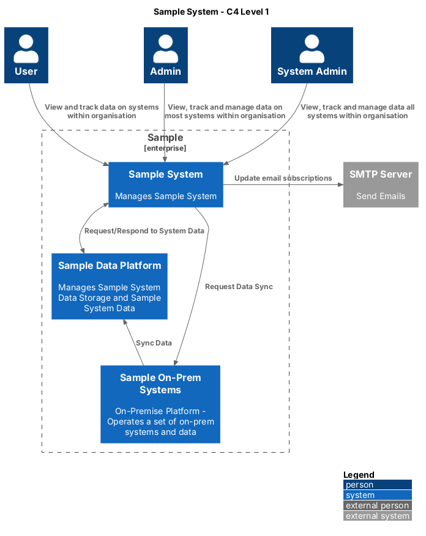
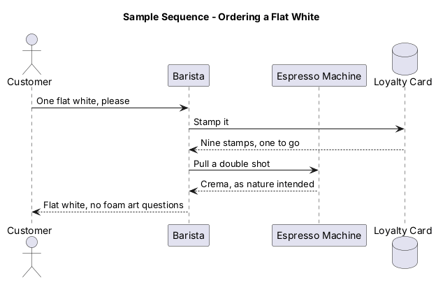

# PlantUML Generator

[](https://github.com/stphnwlsh/PlantUMLGenerator/actions/workflows/build.yml)
[](LICENSE)

Diagrams as code, without installing Java, Graphviz or PlantUML on your machine. Write `.puml` files, run one script, get PNG and SVG images next to them. Docker does the rest, and it doesn't complain about it.

Use it as a home for your team's architecture diagrams, or copy `Dockerfile` and `generate.sh` into a repository that already has some.



## Quick start

You need [Docker](https://docs.docker.com/get-started/get-docker/) and a bash shell. On Windows, that's WSL or Git Bash.

```bash
git clone https://github.com/stphnwlsh/PlantUMLGenerator.git
cd PlantUMLGenerator
./generate.sh
```

The first run builds the image, so give it a minute. After that it's quick.

## Drawing your own

1. Add a `.puml` file anywhere in the repository. The `Diagrams` folder is a good start.
1. Run `./generate.sh`, or `./generate.sh Diagrams/My-Diagram.puml` for just that one.
1. Commit the `.puml` file and its images together, so the pictures always match the code.

Every `.puml` file gets a `.png` and an `.svg` with the same name, in the same folder.

| File | What it shows |
| --- | --- |
| [Sample-System-C4-Level-1.puml](Diagrams/Sample-System-C4-Level-1.puml) | A [C4](https://c4model.com) context diagram, using the C4 library that ships inside PlantUML, so there's no download at render time |
| [Sample-Sequence.puml](Diagrams/Sample-Sequence.puml) | A sequence diagram about the most important process in any office |



## What's in the box

| Path | What it is |
| --- | --- |
| `Dockerfile` | A Java runtime, Graphviz, fonts and the PlantUML jar, all in one small image |
| `generate.sh` | Builds the image, finds every `.puml` file and draws each one as PNG and SVG |
| `Diagrams/` | The samples. Delete them once you've got your own. |
| `.github/workflows/build.yml` | Checks the script, generates every diagram and uploads the images on every pull request |

The script runs the container as you, so the images belong to you rather than to root. Nobody needs `sudo` to delete a PNG.

## Changing the PlantUML version

The version lives in one place, the `PLANTUML_VERSION` argument in the `Dockerfile`. Change it to any [PlantUML release](https://github.com/plantuml/plantuml/releases), or try one out without editing anything:

```bash
docker build --build-arg PLANTUML_VERSION=1.2026.9 --tag plantuml-generator .
```

Dependabot keeps the Java base image current.

## Help me with PlantUML

If you aren't a [PlantUML genius](https://media.giphy.com/media/2wUzjQMSsQKZzLdWj4/giphy.gif) yet, these will get you there:

1. [PlantUML guide](https://plantuml.com/guide)
1. [Sequence diagrams](https://plantuml.com/sequence-diagram)
1. [C4-PlantUML](https://github.com/plantuml-stdlib/C4-PlantUML)
1. [The PlantUML standard library](https://plantuml.com/stdlib), everything you can `!include` without a download

## Contributing

Bug reports, ideas and pull requests are all welcome. [CONTRIBUTING.md](CONTRIBUTING.md) explains how, and the [code of conduct](CODE_OF_CONDUCT.md) explains how to be excellent to each other. Security problems go through the [security policy](SECURITY.md), not an issue.

If it saves you some time, you can [sponsor the work](https://github.com/sponsors/stphnwlsh). It also funds [Lean Mean Clean Apps](https://leanmeancleanapps.github.io), and the coffee.

## Licence

[MIT](LICENSE). PlantUML itself is licensed separately. See [plantuml.com/license](https://plantuml.com/license).
